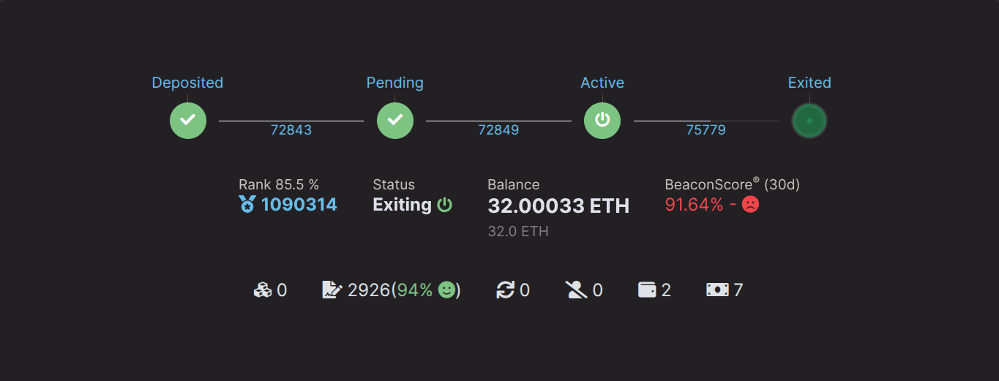

# Exiting a Megapool Validator

If you no longer want to run a megapool validator and want to access the full balance locked on the Beacon Chain, you will have to follow
a couple of steps. This page serves to walk you through the process of exiting a megapool validator.

1. Send a voluntary exit request to the Beacon Chain (manual)
2. Notify validator exit (automated by the smart node)
3. Notify final balance (automated by the smart node)

## Sending an Exit Request to the Beacon Chain

To send an exit request to the Beacon Chain, use the `rocketpool megapool exit-validator` command in the smart node. You will be presented with a list of validators that can be exited.

```
staker@node:~$ rocketpool megapool exit-validator

Please select a validator to EXIT:
1: ID: 1 - Index: 1269834 Pubkey: 0x9455594c2f02674922eb6dee40d096f3203dd1762aa7f1a988ab6c277a62418ec3abfb460b57f33f13a5922e9551d5cc
2: ID: 2 - Index: 1269835 Pubkey: 0xa188774e1adf42db768230541403347a8d2ebcd8386b7f5662bcf1004e17d8d53303889a7e527448cf29bff9bde34bb9
3: ID: 3 - Index: 1269851 Pubkey: 0xa3e211e95a542ffaf8467ba211a3d893b58c59204dab8c32df29f0cfda3f9ce485a3bc13a50e4c205f912613521ed203
4: ID: 7 - Index: 1274411 Pubkey: 0xb5369a5f8550daa07476378dc4864f08b74d4950e28c74844527b59b1e9dea9fd376ea3bd171ee8fba7de866cd4ea37e
5: ID: 8 - Index: 1275239 Pubkey: 0xa56660fa14f0cb7a7030ea0c68a075c7fd700d98ee3afb498030f2bafbadfbf29703bf8fe8ccc9e1f2332b96dcb51ee2
```

Once you've selected a validator, the smart node will follow up with an additional prompt. Confirm that you've selected the validator you intend on exiting, then
type `y`, then press `enter` to send a voluntary exit request to the Beacon Chain. This action does not require any gas. It sends a signed message from your node to the beacon chain to voluntarily
exit the validator.

```
NOTE:
You are about to exit a validator. This will tell each validator to stop all activities on the Beacon Chain.
Please continue to run your validators until each one you've exited has been processed by the exit queue.
You can watch their progress on the https://beaconcha.in explorer.
Your funds will be locked on the Beacon Chain until they've been withdrawn, which will happen automatically (this may take a few days).
Once your funds have been withdrawn, you can run `rocketpool megapool notify-validator-exit` to distribute them to your withdrawal address.

Are you sure you want to EXIT validator id 1? [y/n]
y

Successfully requested to exit validator id 1.
```

Your node sends a voluntary exit request to the Beacon Chain. At this point, your validator should be in the `active_exiting` Beacon Chain state. You can confirm this by running the
`rocketpool megapool validators` command and checking for the validator you just requested an exit for:

```

Megapool Validator ID:        1
Validator pubkey:             0x9455594c2f02674922eb6dee40d096f3203dd1762aa7f1a988ab6c277a62418ec3abfb460b57f33f13a5922e9551d5cc
Validator active:             yes
Validator index:              1269834
Beacon status:                active_exiting
Express Ticket Used:          no
```



::: tip NOTE
Your validator will continue making attestations until it is processed by the Beacon Chain exit queue, so please keep your node online during this process! It might take a few days or longer.
This website is pretty handy for checking the current queue time: https://www.validatorqueue.com/
:::

## Notify Validator Exit

In the previous stage `active_exiting`, your node was making attestations while it was subject to the Beacon Chain exit queue. The time varies depending on
how much ETH is waiting to exit.

After your validator makes it to the end of this queue, it transitions into the `exited_unslashed` state. As soon as your exit request is processed, your smart node will automatically call `notify validator exit`, signalling
to the Rocket Pool protocol that your validator is in the `active_exiting` state and is nearly withdrawable.

::: warning WARNING
This step is fully automated by the Smart Node within the `rocketpool_node` task loop, so it's very important to keep your node online during the process.
The exit must be notified at least 112 epochs (about 12 hours) before your validator becomes withdrawable. If it is notified later, a `0.05 ETH` fine is added to your node's debt,
which is deducted from your share of the final balance. Please monitor the status of your node throughout the entire validator exit process.
:::

```
Megapool Validator ID:        1
Validator pubkey:             0x9455594c2f02674922eb6dee40d096f3203dd1762aa7f1a988ab6c277a62418ec3abfb460b57f33f13a5922e9551d5cc
Validator active:             no
Validator index:              1269834
Beacon status:                exited_unslashed
Express Ticket Used:          no
```

The status on beaconcha.in should look like:


After 256 epochs on the Beacon Chain, the full 32 ETH along with other accumulated rewards will be sent to your node's megapool.

## Notify Final Balance

At this point, your validator is fully exited from the Beacon Chain and the final withdrawal is sent from the Beacon Chain to your megapool. Your smart node will automatically call `notify final balance`.
This call fully ends your megapool validator's duties and also distributes your portion of the balance to your node's ETH withdrawal address. If you've kept your node online and automatic duties such as `notify 
validator exit` and `notify final balance` were performed, no further steps are required on your end.

## Notifying Manually

Most node operators can skip this section.
Your node checks for both notifications every few minutes and sends them on its own. If it was offline during the exit, it catches up as soon as it is back online and synced.

You only need to send them yourself if your node won't: when automatic transactions are disabled (the **Automatic TX Gas Threshold** in the **Smart Node and TX Fees** settings is `0`), or when the gas price stays above your threshold. In that case, run these in order:

```shell
rocketpool megapool notify-validator-exit
rocketpool megapool notify-final-balance
```

Each command lists the validators that are ready to be notified.
`notify-validator-exit` works as soon as the Beacon Chain has processed your exit request; send it at least 112 epochs (about 12 hours) before the validator becomes withdrawable to avoid the fine.
`notify-final-balance` works once the exit has been notified and the Beacon Chain has sent the validator's final withdrawal to your megapool.

Don't leave them unsent. Your megapool can't distribute rewards between the two notifications, and if the exit isn't notified in time, the Oracle DAO can pause your megapool's reward distribution until it is.
If you don't notify the final balance yourself, anyone else can do it for you once 7 days have passed since the final withdrawal (longer if the validator lost ETH). Your share then stays in your megapool instead of going to your withdrawal address, and you can claim it with `rocketpool megapool claim`.
