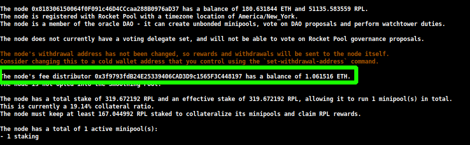
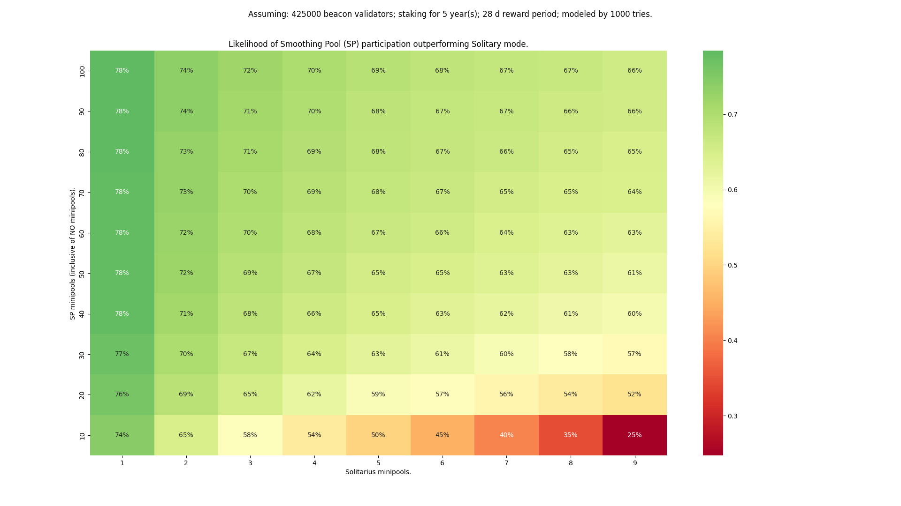

# Distribuidores de Tarifas y el Smoothing Pool

Los operadores de nodos reciben **priority fees** (**propinas**) de las transacciones que incluyen en cualquier bloque que proponen a la cadena de Ethereum.
Estas tarifas provienen y permanecen en la capa de Execution.

A diferencia de la mayoría de las recompensas de validación que se generan en la capa de Consensus y se retiran automáticamente periódicamente, estas tarifas son _inmediatamente líquidas_.
En general, las priority fees proporcionan casi tanto ETH como las recompensas de Beacon Chain, por lo que son un muy buen beneficio de la Fusión.

::: tip NOTA
Como un recordatorio rápido, aquí hay un desglose de los diferentes tipos de recompensas y en qué capa se proporcionan:

- Capa de Consensus: attestations, propuestas de bloques, comités de sincronización, reportes de slashing
- Capa de Execution: priority fees y MEV (discutido en la siguiente sección) de propuestas de bloques

:::

## Destinatarios de Tarifas

Cuando propones un bloque en la cadena de Ethereum, el protocolo necesita saber dónde enviar las propinas de cada transacción incluida en tu bloque.
No puede enviarlas a la dirección de tu validador, porque esa está en la capa de Consensus - no en la capa de Execution.
No puede enviarlas a la dirección de tu minipool, porque tiene que funcionar también para stakers solo y los stakers solo no tienen una dirección en la capa de Execution adjunta a sus validadores de la manera en que lo hace Rocket Pool.

En su lugar, la forma en que funciona es bastante directa: cuando Rocket Pool inicia tu cliente Validator, pasa un argumento llamado **fee recipient**.
El fee recipient es simplemente una dirección en la capa de Execution donde deseas que vayan las propinas.

El `fee recipient` de tu nodo puede ser uno de los siguientes contratos especiales:

- Tu **Fee Distributor** personal del nodo
- El contrato megapool de tu nodo
- El **Smoothing Pool** (opt-in)

El Smart Node establecerá automáticamente el fee recipient correcto según tu configuración:

| Estado del Smoothing Pool | Tiene Validadores Megapool | Tiene Minipools | Fee Recipient                                                                                                                                                                                                                           |
| ------------------------- | -------------------------- | --------------- | --------------------------------------------------------------------------------------------------------------------------------------------------------------------------------------------------------------------------------------- |
| Inscrito                  | No                         | Sí              | Dirección del Smoothing Pool                                                                                                                                                                                                            |
| Inscrito                  | Sí                         | No              | Dirección del Smoothing Pool                                                                                                                                                                                                            |
| Inscrito                  | Sí                         | Sí              | Dirección del Smoothing Pool (todos los validadores)                                                                                                                                                                                    |
| No inscrito               | No                         | Sí              | Dirección del contrato Fee Distributor                                                                                                                                                                                                  |
| No inscrito               | Sí                         | No              | Dirección del contrato megapool                                                                                                                                                                                                         |
| No inscrito               | Sí                         | Sí              | Validadores megapool → Dirección megapool<br>Validadores minipool → Dirección Fee Distributor<br>(Establecido por validador mediante la [keymanager API](https://ethereum.github.io/keymanager-APIs/#/Fee%20Recipient/setFeeRecipient)) |

Rocket Pool está diseñado para distribuir equitativamente estas recompensas entre tú y los stakers del pool de rETH, de la misma manera que distribuye equitativamente tus recompensas de Beacon chain: tu porción de cualquier priority fee que ganen tus validadores de minipool irá a ti (más la comisión promedio de todos tus minipools), y la porción restante irá a los stakers del pool (menos tu comisión promedio).
La porción exacta depende del número de minipools vinculados de 8 ETH, 16 ETH, y validadores de megapool vinculados de 4 ETH que tengas.

En resumen, el **Fee Distributor** es un contrato único adjunto a tu nodo que recopila y divide equitativamente tus priority fees entre tú y los stakers de rETH.
Es como tu propia bóveda personal para priority fees.
Cualquiera (incluido tú) puede distribuir su saldo en cualquier momento para asegurar que las recompensas siempre estén disponibles para los stakers de rETH.

El **Smoothing Pool** es un contrato especial de opt-in que permite a todos los operadores de nodos participantes agregar y agrupar sus priority fees juntas, y las distribuye equitativamente entre los participantes durante cada intervalo de recompensas de Rocket Pool (actualmente cada 28 días) y los stakers del pool de rETH.
Esta es una característica muy atractiva para los operadores de nodos que no quieren preocuparse por el factor de suerte involucrado en obtener propuestas de bloques con priority fees altas, y preferirían tener un conjunto agradable, regular y consistente de ganancias mensuales.

Cubriremos ambos a continuación para que entiendas la diferencia y si deseas unirte o no al Smoothing Pool.

::: tip NOTA
Los minipools creados después del 2024-10-28 recibían antes una comisión de bonificación (hasta un 14 % en total) a través del Smoothing Pool. Según lo definido en [RPIP-62](https://rpips.rocketpool.net/RPIPs/RPIP-62), la bonificación terminó cuatro intervalos de recompensas después de Saturn 1 (la última se pagó en junio de 2026). Estos minipools ahora reciben su comisión de contrato del 5 %, estés o no en el Smoothing Pool.
:::

## Tu Fee Distributor

Tu Fee Distributor es un contrato único en la capa de Execution que es **específico para tu nodo**.
Contendrá todas las priority fees que has ganado con el tiempo, y contiene la lógica requerida para dividirlas y distribuirlas equitativamente a los stakers del pool de rETH y tu dirección de retiro.
Este proceso de distribución **puede ser llamado por cualquiera** (incluidos los stakers de rETH), y puede hacerse **en cualquier momento**.
Si alguien que no seas tú lo distribuye, tu parte se retiene como [recompensas no reclamadas](#claiming-unclaimed-rewards) hasta que la reclames.
No tiene un límite de tiempo antes de que las recompensas expiren.

La dirección de tu Fee Distributor de nodo es **determinísticamente basada en tu dirección de nodo**.
Eso significa que se conoce de antemano, antes de que el Fee Distributor sea siquiera creado.

Los nuevos nodos de Rocket Pool crearán (inicializarán) automáticamente el contrato Fee Distributor de su nodo al registrarse.
Esto solo necesita ejecutarse una vez.

Una consecuencia interesante de esto es que la dirección de tu Distributor puede comenzar a acumular un saldo **antes** de que hayas inicializado tu contrato Fee Distributor.
Esto está bien, porque tu Distributor obtendrá acceso a todo este saldo existente tan pronto como lo inicialices.

### Ver su Dirección y Saldo

Puedes ver la dirección y saldo de tu fee distributor como parte de:

```shell
rocketpool node status
```

La salida se verá así:



### Reclamar tarifas de tu Fee Distributor

Puedes reclamar y distribuir todo el saldo de tu fee distributor usando el siguiente comando:

```shell
rocketpool node distribute-fees
```

Esto enviará tu parte de las recompensas a tu **dirección de retiro**.

::: warning NOTA SOBRE EVENTOS IMPONIBLES
Cualquiera puede distribuir tu distribuidor de tarifas (para evitar que retengas las recompensas de rETH como rehén).
Rocket Pool también lo distribuye automáticamente cada vez que se cierra uno de tus minipools, para que las tarifas acumuladas se repartan con la comisión media de tu nodo antes de que cambie.
Puedes tener un evento imponible cada vez que se distribuye tu distribuidor de tarifas.

Por favor, ten en cuenta estas condiciones al decidir si usar o no el Smoothing Pool (discutido a continuación).
:::

<span id="claiming-unclaimed-rewards"></span>

### Reclamar recompensas no reclamadas

Tu parte va directamente a tu dirección de retiro solo cuando el distribuidor de tarifas es distribuido por la dirección de tu nodo o tu dirección de retiro, por ejemplo con `rocketpool node distribute-fees`.
Desde la actualización Saturn 1, cuando cualquier otra persona lo distribuye (incluido el propio Rocket Pool cuando cierras un minipool), tu parte se reserva como **recompensas no reclamadas**.
Las recompensas no reclamadas no caducan, y solo la dirección de tu nodo o tu dirección de retiro pueden reclamarlas.

Para comprobar si tienes recompensas no reclamadas y reclamarlas, ejecuta:

```shell
rocketpool node claim-unclaimed-rewards
```

Si tienes alguna, mostrará la cantidad antes de pedirte que confirmes la reclamación:

```
The node's withdrawal address is 0x4ACb4E5E5A9a5EfB1f4D3eE2f6E5A13bB0E8f0a7
You have 0.012345 ETH in unclaimed rewards.
Your node 0xE8325F5f4486c2FF2AC7B522Fbc9eB249d46C936 has rewards that were distributed to its unclaimed rewards balance instead of its withdrawal address. This happens whenever your fee distributor is distributed by anyone other than your node or withdrawal address.
Claiming will send them to your current withdrawal address.
```

Las recompensas se envían a tu dirección de retiro **actual**.

### El Sistema de Penalización

Para asegurar que los operadores de nodos no "hagan trampa" al modificar manualmente el fee recipient usado en su cliente Validator, Rocket Pool emplea un sistema de penalización.

El Oracle DAO puede penalizar a los operadores de nodos que no sigan las reglas del protocolo.

Si un nodo está _opted out_ del Smoothing Pool, las siguientes direcciones se consideran fee recipients válidos:

- La dirección de rETH
- La dirección del Smoothing Pool
- El contrato fee distributor del nodo
- El contrato megapool del nodo

Si un nodo está _opted in_ al Smoothing Pool, la siguiente dirección se considera un fee recipient válido:

- La dirección del Smoothing Pool

Un fee recipient diferente a una de las direcciones válidas anteriores se considera **inválido**.

El software Smart Node establece automáticamente el fee recipient correcto según tu configuración (si estás inscrito en el Smoothing Pool, y si tienes validadores de megapool, minipools, o ambos). Para nodos con tanto validadores de megapool como minipools mientras no están inscritos, el fee recipient se establece por validador usando la keymanager API. La lista completa de condiciones se resume [aquí](/es/node-staking/fee-distrib-sp#destinatarios-de-tarifas).

El software Smart Node está diseñado para asegurar que los usuarios honestos nunca sean penalizados, incluso si debe desconectar el cliente Validator para hacerlo.
Si esto sucede, dejarás de atestiguar y verás mensajes de error en tus archivos de registro sobre por qué el Smart Node no puede configurar correctamente tu fee recipient.

## El Smoothing Pool

El **Smoothing Pool** es una característica única de opt-in de la red de Rocket Pool que está disponible para nuestros operadores de nodos.
Esencialmente, se convierte en el fee recipient para cada operador de nodo que opta por participar y acumula colectivamente las priority fees de los bloques propuestos por esos operadores de nodos en un gran pool. Durante un checkpoint de recompensas de Rocket Pool (los mismos utilizados para distribuir recompensas de RPL), el saldo total de ETH del pool se distribuye equitativamente a los stakers del pool y los operadores de nodos que optaron por participar.

En esencia, el Smoothing Pool es una forma de eliminar efectivamente la aleatoriedad asociada con ser seleccionado para propuestas de bloques.
Si alguna vez has tenido una racha de mala suerte y pasaste meses sin una propuesta, o si tus propuestas de bloques solo tienen priority fees bajas, puedes encontrar el Smoothing Pool muy emocionante.

Para facilitar la comprensión de las matemáticas, el miembro de la comunidad Ken Smith ha elaborado un [análisis masivo](https://raw.githubusercontent.com/htimsk/SPanalysis/main/report/Analysis%20of%20the%20Smoothing%20Pool.pdf) comparando la rentabilidad del Smoothing Pool y el Fee Distributor, que se resume muy bien con este gráfico:



En resumen, mientras el Smoothing Pool tenga más minipools que tú, es más probable que salgas beneficiado al unirte.

### Las Reglas

El Smoothing Pool usa las siguientes reglas:

- Durante un checkpoint de recompensas de Rocket Pool cuando se distribuye el saldo del Smoothing Pool entre los operadores de nodo (teniendo en cuenta su comisión), los operadores de nodo con RPL en stake, los stakers de rETH, y potencialmente el DAO de Rocket Pool. Los porcentajes exactos son determinados por la [gobernanza del Protocol Dao (pDAO) de Rocket Pool](/pdao/overview)

- Optar por participar en el Smoothing Pool se hace a **nivel de nodo**. Si optas por participar, todos tus minipools y validadores de megapool están incluidos.

- Cualquiera puede optar por participar en cualquier momento. Deben esperar un intervalo de recompensas completo (3 días en Hoodi, 28 días en Mainnet) antes de optar por salir para evitar jugar con el sistema (por ejemplo, salir del SP justo después de ser seleccionado para proponer un bloque).
  - Una vez que optan por salir, deben esperar otro intervalo completo para volver a optar por participar.

- El Smoothing Pool calcula la "participación" de cada validador (porción del ETH del pool para el intervalo) propiedad de cada nodo que optó por participar.
  - La participación es una función del rendimiento de tu validador durante el intervalo (calculado mirando cuántas attestations enviaste en la Beacon Chain, y cuántas perdiste), y tu tasa de comisión.

- La participación total de tu nodo es la suma de las participaciones de tus validadores.

- La participación total de tu nodo se escala según la cantidad de tiempo que optaste por participar.
  - Si optaste por participar durante el intervalo completo, recibes tu participación completa.
  - Si optaste por participar durante el 30% de un intervalo, recibes el 30% de tu participación completa.

Si estás interesado en los detalles técnicos completos del cálculo de recompensas del Smoothing Pool, por favor revisa [la especificación completa aquí](https://github.com/rocket-pool/rocketpool-research/blob/master/Merkle%20Rewards%20System/rewards-calculation-spec.md#smoothing-pool-rewards).

### Unirse y Salir del Smoothing Pool

Para optar por participar en el Smoothing Pool, ejecuta el siguiente comando:

```shell
rocketpool node join-smoothing-pool
```

Esto te registrará como opt-in en los contratos de Rocket Pool y cambiará automáticamente el `fee recipient` de tu cliente Validator del contrato distributor de tu nodo al contrato del Smoothing Pool.

Para salir del pool, ejecuta este comando:

```shell
rocketpool node leave-smoothing-pool
```

Esto te registrará como opted-out en los contratos de Rocket Pool, y una vez que haya pasado un pequeño retraso, cambiará automáticamente el `fee recipient` de tu cliente Validator del contrato del Smoothing Pool de nuevo al contrato Fee Distributor de tu nodo.

### Reclamar Recompensas del Smoothing Pool

Las recompensas del Smoothing Pool se agrupan junto con RPL al final de cada intervalo de recompensas usando el sistema de recompensas de Redstone.
Reclamarlas es tan simple como ejecutar:

```shell
rocketpool node claim-rewards
```

Si optaste por participar en el Smoothing Pool, notarás que la cantidad de ETH que recibes por cada intervalo es mayor que cero:

```
Welcome to the new rewards system!
You no longer need to claim rewards at each interval - you can simply let them accumulate and claim them whenever you want.
Here you can see which intervals you haven't claimed yet, and how many rewards you earned during each one.

Rewards for Interval 0 (2022-08-04 01:35:39 -0400 EDT to 2022-09-01 01:35:39 -0400 EDT):
	Staking:        50.820133 RPL
	Smoothing Pool: 0.000000 ETH

Rewards for Interval 1 (2022-09-01 01:35:39 -0400 EDT to 2022-09-29 01:35:39 -0400 EDT):
	Staking:        40.668885 RPL
	Smoothing Pool: 0.096200 ETH

Total Pending Rewards:
	91.489018 RPL
	0.096200 ETH

Which intervals would you like to claim? Use a comma separated list (such as '1,2,3') or leave it blank to claim all intervals at once.
```

Ten en cuenta que las recompensas del Smoothing Pool en el Intervalo 1 aquí indican que el nodo optó por participar durante ese intervalo y recibió recompensas en consecuencia.

Cubriremos más sobre la reclamación de recompensas de RPL y Smoothing Pool más adelante en la guía, en la sección [Reclamar Recompensas](./rewards).

## Próximos Pasos

Una vez que hayas decidido si deseas unirte o no al Smoothing Pool, echa un vistazo a la siguiente sección sobre MEV y recompensas de MEV.
