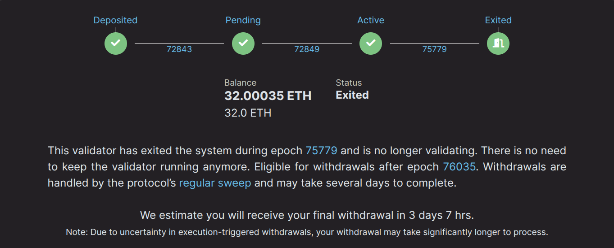

# Sortir d'un validateur megapool

Si vous ne souhaitez plus faire fonctionner un validateur megapool et souhaitez accéder au solde complet bloqué sur la Beacon Chain, vous devrez suivre
quelques étapes. Cette page vous guide à travers le processus de sortie d'un validateur megapool.

1. Envoyer une demande de sortie volontaire à la Beacon Chain (manuelle)
2. Notifier la sortie du validateur (automatisé par le smart node)
3. Notifier le solde final (automatisé par le smart node)

## Envoyer une demande de sortie à la Beacon Chain

Pour envoyer une demande de sortie à la Beacon Chain, utilisez la commande `rocketpool megapool exit-validator` dans le smart node. Une liste des validateurs pouvant être retirés vous sera présentée.

```
staker@node:~$ rocketpool megapool exit-validator

Please select a validator to EXIT:
1: ID: 1 - Index: 1269834 Pubkey: 0x9455594c2f02674922eb6dee40d096f3203dd1762aa7f1a988ab6c277a62418ec3abfb460b57f33f13a5922e9551d5cc
2: ID: 2 - Index: 1269835 Pubkey: 0xa188774e1adf42db768230541403347a8d2ebcd8386b7f5662bcf1004e17d8d53303889a7e527448cf29bff9bde34bb9
3: ID: 3 - Index: 1269851 Pubkey: 0xa3e211e95a542ffaf8467ba211a3d893b58c59204dab8c32df29f0cfda3f9ce485a3bc13a50e4c205f912613521ed203
4: ID: 7 - Index: 1274411 Pubkey: 0xb5369a5f8550daa07476378dc4864f08b74d4950e28c74844527b59b1e9dea9fd376ea3bd171ee8fba7de866cd4ea37e
5: ID: 8 - Index: 1275239 Pubkey: 0xa56660fa14f0cb7a7030ea0c68a075c7fd700d98ee3afb498030f2bafbadfbf29703bf8fe8ccc9e1f2332b96dcb51ee2
```

Une fois que vous avez sélectionné un validateur, le smart node affichera une invite supplémentaire. Confirmez que vous avez sélectionné le validateur que vous souhaitez retirer en
tapant `y`, puis appuyez sur `entrée` pour envoyer une demande de sortie volontaire à la Beacon Chain. Cette action ne nécessite pas de gas. Elle envoie un message signé de votre nœud à la beacon chain pour
retirer volontairement le validateur.

```
NOTE:
You are about to exit a validator. This will tell each validator to stop all activities on the Beacon Chain.
Please continue to run your validators until each one you've exited has been processed by the exit queue.
You can watch their progress on the https://beaconcha.in explorer.
Your funds will be locked on the Beacon Chain until they've been withdrawn, which will happen automatically (this may take a few days).
Once your funds have been withdrawn, you can run `rocketpool megapool notify-validator-exit` to distribute them to your withdrawal address.

Are you sure you want to EXIT validator id 1? [y/n]
y

Successfully requested to exit validator id 1.
```

Votre nœud envoie une demande de sortie volontaire à la Beacon Chain. À ce stade, votre validateur devrait être dans l'état `active_exiting` sur la Beacon Chain. Vous pouvez le confirmer en exécutant la
commande `rocketpool megapool validators` et en recherchant le validateur pour lequel vous venez de demander une sortie :

```

Megapool Validator ID:        1
Validator pubkey:             0x9455594c2f02674922eb6dee40d096f3203dd1762aa7f1a988ab6c277a62418ec3abfb460b57f33f13a5922e9551d5cc
Validator active:             yes
Validator index:              1269834
Beacon status:                active_exiting
Express Ticket Used:          no
```


::: tip NOTE
Votre validateur continuera à effectuer des attestations jusqu'à ce qu'il soit traité par la file d'attente de sortie de la Beacon Chain, alors gardez votre nœud en ligne pendant ce processus ! Cela peut prendre quelques jours ou plus.
Ce site est pratique pour vérifier le temps d'attente actuel de la file : https://www.validatorqueue.com/
:::

## Notifier la sortie du validateur

Dans l'étape précédente `active_exiting`, votre nœud effectuait des attestations pendant qu'il était soumis à la file d'attente de sortie de la Beacon Chain. Le temps varie selon
la quantité d'ETH en attente de sortie.

Après que votre validateur atteint la fin de cette file, il passe à l'état `exited_unslashed`. Dès que votre demande de sortie est traitée, votre smart node appellera automatiquement `notify validator exit`, signalant
au protocole Rocket Pool que votre validateur est dans l'état `active_exiting` et est presque en attente de retrait.

::: warning AVERTISSEMENT
Cette étape est entièrement automatisée par le Smart Node dans la boucle de tâches `rocketpool_node`, il est donc très important de garder votre nœud en ligne pendant le processus.
La sortie doit être notifiée au moins 112 époques (environ 12 heures) avant que votre validateur ne devienne retirable. Si elle est notifiée plus tard, une amende de `0.05 ETH` est ajoutée à la dette de votre nœud,
qui est déduite de votre part du solde final. Veuillez surveiller l'état de votre nœud pendant tout le processus de sortie du validateur.
:::

```
Megapool Validator ID:        1
Validator pubkey:             0x9455594c2f02674922eb6dee40d096f3203dd1762aa7f1a988ab6c277a62418ec3abfb460b57f33f13a5922e9551d5cc
Validator active:             no
Validator index:              1269834
Beacon status:                exited_unslashed
Express Ticket Used:          no
```

Le statut sur beaconcha.in devrait ressembler à :



Après 256 époques sur la Beacon Chain, les 32 ETH complets ainsi que les autres récompenses accumulées seront envoyés au megapool de votre nœud.

## Notifier le solde final

À ce stade, votre validateur est entièrement sorti de la Beacon Chain et le retrait final est envoyé de la Beacon Chain à votre megapool. Votre smart node appellera automatiquement `notify final balance`.
Cet appel met fin aux fonctions de votre validateur megapool et distribue également votre part du solde à l'adresse de retrait ETH de votre nœud. Si vous avez gardé votre nœud en ligne et que les tâches automatiques telles que `notify
validator exit` et `notify final balance` ont été effectuées, aucune autre étape n'est requise de votre part.

## Notifier manuellement

La plupart des opérateurs de nœuds peuvent ignorer cette section.
Votre nœud vérifie les deux notifications toutes les quelques minutes et les envoie de lui-même. S'il était hors ligne pendant la sortie, il rattrape son retard dès qu'il est de nouveau en ligne et synchronisé.

Vous n'avez besoin de les envoyer vous-même que si votre nœud ne le fait pas : lorsque les transactions automatiques sont désactivées (**Automatic TX Gas Threshold** dans les paramètres **Smart Node and TX Fees** vaut `0`), ou lorsque le prix du gaz reste au-dessus de votre seuil. Dans ce cas, exécutez ces commandes dans l'ordre :

```shell
rocketpool megapool notify-validator-exit
rocketpool megapool notify-final-balance
```

Chaque commande liste les validateurs prêts à être notifiés.
`notify-validator-exit` fonctionne dès que la Beacon Chain a traité votre demande de sortie ; envoyez-la au moins 112 époques (environ 12 heures) avant que le validateur ne devienne retirable pour éviter l'amende.
`notify-final-balance` fonctionne une fois que la sortie a été notifiée et que la Beacon Chain a envoyé le retrait final du validateur à votre megapool.

Ne les laissez pas en suspens. Votre megapool ne peut pas distribuer de récompenses entre les deux notifications, et si la sortie n'est pas notifiée à temps, l'Oracle DAO peut suspendre la distribution des récompenses de votre megapool jusqu'à ce qu'elle le soit.
Si vous ne notifiez pas vous-même le solde final, n'importe qui d'autre peut le faire à votre place une fois que 7 jours se sont écoulés depuis le retrait final (plus longtemps si le validateur a perdu de l'ETH). Votre part reste alors dans votre megapool au lieu d'être envoyée à votre adresse de retrait, et vous pouvez la réclamer avec `rocketpool megapool claim`.
